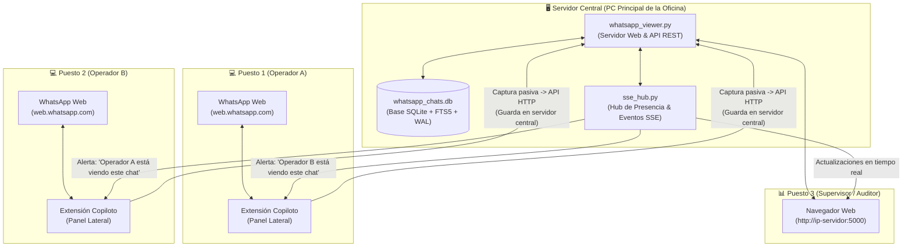
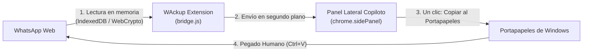
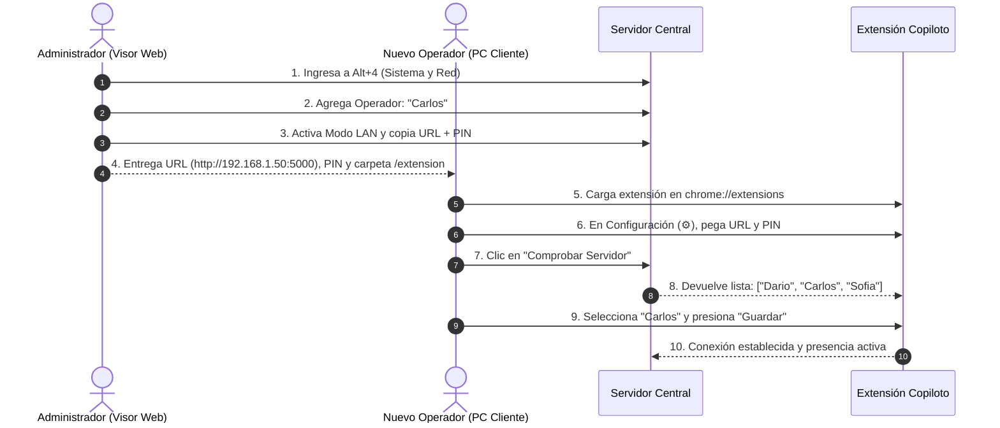

# 📖 Manual de Usuario y Guía Operativa Oficial — WAckup 3.1

> **Versión del Manual:** 3.1.1  
> **Audiencia:** Usuarios finales, Operadores de atención, Supervisores y Administradores de IT.  
> **Objetivo:** Documentar de forma integral, pedagógica y exhaustiva el funcionamiento, características, flujos de trabajo y procedimientos de WAckup 3.1.

---

## 📑 Tabla de Contenidos

1. [Introducción y Conceptos Clave](#1-introducción-y-conceptos-clave)
2. [Arquitectura de Funcionamiento](#2-arquitectura-de-funcionamiento)
3. [Seguridad y Garantía Anti-Ban](#3-seguridad-y-garantía-anti-ban)
4. [Instalación y Puesta en Marcha](#4-instalación-y-puesta-en-marcha)
   - [4.1 Puesto Servidor (PC Principal)](#41-puesto-servidor-pc-principal)
   - [4.2 Puesto Cliente (Operadores en Red Local)](#42-puesto-cliente-operadores-en-red-local)
5. [Guía del Copiloto Lateral (Extensión Chromium)](#5-guía-del-copiloto-lateral-extensión-chromium)
   - [5.1 Conexión Asistida al Servidor y Selección de Operador](#51-conexión-asistida-al-servidor-y-selección-de-operador)
   - [5.2 Semáforo Anti-Colisión y Diferenciación de Clientes](#52-semáforo-anti-colisión-y-diferenciación-de-clientes)
   - [5.3 Tarjeta del Contacto, Grupos y Resolución de Contactos `@lid`](#53-tarjeta-del-contacto-grupos-y-resolución-de-contactos-lid)
   - [5.4 Respuestas Rápidas Prioritarias y Atajos (Alt+1..5)](#54-respuestas-rápidas-prioritarias-y-atajos-alt15)
   - [5.5 Asignación Rápida ("Tomar caso") y Transferencias entre Operadores](#55-asignación-rápida-tomar-caso-y-transferencias-entre-operadores)
   - [5.6 Búsqueda en el Chat (FTS5) en la Solapa Gestión](#56-búsqueda-en-el-chat-fts5-en-la-solapa-gestión)
   - [5.7 CRM Rápido: Notas, Etiquetas y Bitácora](#57-crm-rápido-notas-etiquetas-y-bitácora)
   - [5.8 Solapa Radar en el Copiloto](#58-solapa-radar-en-el-copiloto)
6. [Guía del Visor Web Central](#6-guía-del-visor-web-central)
   - [6.1 Espacio 1: Conversaciones, Filtros Rápidos e Historial FTS5](#61-espacio-1-conversaciones-filtros-rápidos-e-historial-fts5)
   - [6.2 Espacio 2: Radar Kanban de Soporte, SLA Dinámico y Auto-Reapertura](#62-espacio-2-radar-kanban-de-soporte-sla-dinámico-y-auto-reapertura)
   - [6.3 Espacio 3: CRM Comercial, Métricas de Soporte y Plantillas](#63-espacio-3-crm-comercial-métricas-de-soporte-y-plantillas)
   - [6.4 Espacio 4: Administración, Blindaje de Red LAN y Operadores](#64-espacio-4-administración-blindaje-de-red-lan-y-operadores)
7. [Procedimientos Operativos Paso a Paso](#7-procedimientos-operativos-paso-a-paso)
   - [Procedimiento A: Alta y Despliegue de un Nuevo Operador](#procedimiento-a-alta-y-despliegue-de-un-nuevo-operador)
   - [Procedimiento B: Liberación de Sesión Colgada](#procedimiento-b-liberación-de-sesión-colgada)
   - [Procedimiento C: Transferencia de Caso con Nota entre Operadores](#procedimiento-c-transferencia-de-caso-con-nota-entre-operadores)
   - [Procedimiento D: Gestión y Búsqueda por Etiquetas](#procedimiento-d-gestión-y-búsqueda-por-etiquetas)
   - [Procedimiento E: Respaldo y Restauración de Base de Datos](#procedimiento-e-respaldo-y-restauración-de-base-de-datos)
8. [Preguntas Frecuentes y Diagnóstico (FAQ)](#8-preguntas-frecuentes-y-diagnóstico-faq)

---

## 1. Introducción y Conceptos Clave

**WAckup** es una plataforma integral diseñada para resolver tres problemas críticos de los equipos que atienden clientes por WhatsApp Web:

1. **Pérdida de Historial e Independencia:** Garantiza un respaldo pasivo, incremental y perpetuo de chats y archivos multimedia en una base de datos local SQLite bajo control exclusivo de la empresa.
2. **Colisión de Operadores:** Evita que dos personas respondan al mismo cliente a la vez gracias a un sistema de presencia en tiempo real que alerta inmediatamente si un compañero tiene el chat abierto.
3. **Gestión Comercial Desconectada:** Proporciona un Mini-CRM (etiquetas, notas privadas por cliente, embudo Kanban de ventas y respuestas rápidas) sin requerir costosas suscripciones de software externo ni modificar la interfaz de WhatsApp Web.

---

## 2. Arquitectura de Funcionamiento

WAckup opera bajo un modelo **Cliente-Servidor Centralizado**:



### ¿Qué se ejecuta en cada equipo?

| Equipo | ¿Qué ejecuta? | ¿Necesita Python o Base de Datos? | ¿Qué hace? |
| :--- | :--- | :---: | :--- |
| **PC Servidor** | `whatsapp_viewer.py` (o `iniciar_visor.bat`) | **SÍ** (incluido en portable) | Aloja la base SQLite central, recibe los datos y orquesta los eventos en vivo. |
| **Puestos de Operadores** | **Únicamente la extensión** en Chrome/Edge | **NO** | Extrae pasivamente los mensajes de WhatsApp Web y los envía por red al servidor. |
| **Puestos de Supervisión** | **Únicamente el navegador web** | **NO** | Abre la URL del Visor (`http://ip-servidor:5000`) para auditar, ver métricas o etiquetar. |

> [!NOTE]
> Todo lo que chatean los operadores en sus respectivas máquinas se almacena **exclusiva y directamente en la base de datos de la PC Servidor**. Los clientes no guardan bases de datos locales.

---

## 3. Seguridad y Garantía Anti-Ban

WAckup fue diseñado con una **política de estricta pasividad** para erradicar cualquier riesgo de bloqueo o suspensión de la cuenta de WhatsApp:



* **Cero inyección en el DOM:** No se agregan botones, paneles ni scripts visuales dentro de la ventana de WhatsApp Web.
* **Cero automatización ni clics sintéticos:** WAckup no envía mensajes de forma autónoma. Al hacer clic en una plantilla de respuesta, el texto se copia al portapapeles del sistema para que el operador lo pegue (`Ctrl + V`) voluntariamente.
* **Lectura Criptográfica Limpia:** Captura claves efímeras estándar de `window.crypto.subtle` e indexa datos que WhatsApp ya almacenó en el navegador (`IndexedDB`). WhatsApp no puede detectar la extensión como un bot externo.

---

## 4. Instalación y Puesta en Marcha

### 4.1 Puesto Servidor (PC Principal)

Es el equipo que actuará como centro de datos de la oficina.

#### Opción Recomendada: Paquete Portable (Sin instalación de software)
1. Descargue `WAckup_Portable_v3.1.1.zip` y descomprímalo en una carpeta fija (por ejemplo, `C:\WAckup`).
2. Haga doble clic en **`iniciar_visor.bat`**.
3. El sistema se iniciará en silencio, se alojará en la **Bandeja del Sistema (System Tray)** junto al reloj de Windows y abrirá automáticamente el Visor Web en su navegador predeterminado (`http://127.0.0.1:5000`).

#### Opción Técnica / Desarrollador:
```bash
git clone https://github.com/dbonotti/wackup.git
cd wackup
pip install -r requirements.txt
python whatsapp_viewer.py --console
```

---

### 4.2 Puesto Cliente (Operadores en Red Local)

Para habilitar a un compañero de trabajo en otra computadora de la red local:

1. **Copie únicamente la carpeta `extension/`** del proyecto a la computadora del operador.
2. Abra **Google Chrome**, **Microsoft Edge** o **Brave** e ingrese a:
   * En Chrome/Brave: `chrome://extensions`
   * En Edge: `edge://extensions`
3. Active el interruptor **"Modo de desarrollador"** (en el extremo superior derecho).
4. Presione el botón **"Cargar descomprimida"** y seleccione la carpeta `extension/`.
5. Fije el icono de WAckup en la barra de herramientas del navegador para tenerlo siempre a mano.

---

## 5. Guía del Copiloto Lateral (Extensión Chromium)

El Copiloto funciona dentro del panel lateral nativo de Chromium (`chrome.sidePanel`), lo que permite mantenerlo siempre a la vista junto a WhatsApp Web sin interferir con la pantalla del chat.

```
+------------------------------------+--------------------------+
|                                    |  WAckup Copilot       ⚙️ |
|                                    |--------------------------|
|                                    | [📝 Gestión]  [🔔 Radar] |
|                                    |--------------------------|
|          WhatsApp Web              | 👁️ Martín (en este chat)|
|       (web.whatsapp.com)           | 👤 Juan Pérez  (SLA: 4m) |
|                                    | 📞 +54 9 11 1234-5678 📋 |
|                                    |--------------------------|
|                                    | 🔍 Buscar en este Chat   |
|                                    | [presupuesto...] [▲][▼]🔍|
|                                    |--------------------------|
|                                    | 🏷️ [Cliente] [#VIP]      |
|                                    | 📝 Nota Fija & Bitácora  |
|                                    | ⚡ Respuestas Rápidas    |
+------------------------------------+--------------------------+
```

### 5.1 Conexión Asistida al Servidor y Selección de Operador

Al utilizar la extensión por primera vez o al trabajar en red local:

1. Haga clic en el botón de engranaje **⚙️ (Configuración del Servidor)** en la esquina superior derecha del Copiloto.
2. Ingrese la **URL del Servidor**:
   * Si está en la misma PC donde corre el servidor: `http://localhost:5000`
   * Si es un puesto de red LAN: `http://<IP-DEL-SERVIDOR>:5000` (ejemplo: `http://192.168.1.50:5000`).
3. Ingrese el **PIN de Acceso LAN** (generado por el administrador en el Visor Web).
4. Presione **🔍 Comprobar Servidor y Cargar Operadores**.
   - El sistema validará la conectividad y consultará la lista de operadores registrados en el servidor.
5. En el menú desplegable **Operador Asignado**, seleccione su nombre:
   - Si un operador ya está conectado en otra terminal, aparecerá indicado con **`(En línea)`**.
   - Si sabe que se trata de su propia sesión previa que quedó abierta, selecciónela y presione **`⚡ Liberar sesión en uso`**.
6. Presione **💾 Guardar Configuración**. El semáforo del encabezado pasará a estado verde `🟢 Conectado`.

---

### 5.2 Semáforo Anti-Colisión y Diferenciación de Clientes

Cuando usted selecciona una conversación en WhatsApp Web o en el Visor Web, el sistema informa de inmediato a todos los operadores conectados:

* **Si el chat está libre:** El Copiloto mostrará su estado de visualización sin advertencias.
* **Si otro compañero abre el mismo chat:** Aparecerá una franja destacada con el mensaje y avatar correspondiente:
  > **⚠️ Advertencia:** *Martín está viendo este chat ahora.*
* **Diferenciación de Origen (`whatsapp_web` vs `visor`):** El semáforo distingue si el compañero tiene el chat abierto activamente en **WhatsApp Web** o en una pestaña de auditoría del **Visor Web**, permitiendo coordinar la atención con máxima claridad.
* **Limpieza Inmediata de Presencia:** Al cambiar de conversación o cerrar la pestaña, la presencia se libera instantáneamente en el servidor mediante el canal SSE, evitando "fantasmas" o bloqueos residuales.
* **Filtro de Identidad Propia:** El sistema reconoce si usted mismo tiene el chat abierto en el Copiloto y en el Visor Web, suprimiendo falsas alarmas sobre su propio usuario.

---

### 5.3 Tarjeta del Contacto, Grupos y Resolución de Contactos `@lid`

La cabecera de la solapa **Gestión** adapta su visualización según el tipo de conversación activa en WhatsApp Web:

* **Contactos Individuales:**
  - Identificados con el avatar **`👤`**.
  - **Resolución de `@lid`:** WhatsApp Web utiliza frecuentemente identificadores internos anónimos (`123456789@lid`) que ocultan el número real. El Copiloto inspecciona la base de datos y **resuelve automáticamente el `@lid` a su número telefónico internacional real** (ejemplo: `+54 9 11 9876-5432`).
  - **Botón 📋 Copiar teléfono:** Con 1 clic copia el número limpio para pegarlo en WhatsApp Web u otras herramientas.
* **Grupos de WhatsApp (`@g.us`):**
  - Identificados automáticamente con el avatar **`👥`**.
  - En lugar de mostrar el identificador técnico crudo e ilegible (`120363...@g.us`), muestra una insignia descriptiva con el conteo de mensajes registrados: **`👥 Grupo · X msgs`** (o *Grupo de WhatsApp* si no tiene mensajes previos).
  - Al hacer clic, copia el identificador técnico del grupo aclarando expresamente *"ID de grupo copiado"*.
* **Canales de WhatsApp (`@newsletter`):**
  - Identificados con el avatar **`📢`** y la insignia **`📢 Canal · X msgs`**.
* **Métrica de SLA y Asignación:** Muestra el tiempo de espera actual del cliente y permite asignar o transferir el caso.

---

### 5.4 Respuestas Rápidas Prioritarias y Atajos (Alt+1..5)

Para agilizar la atención, las respuestas rápidas se ubican en el sector superior de la solapa Gestión con ergonomía optimizada:

* **Buscador Instantáneo:** Permite filtrar plantillas en tiempo real escribiendo palabras clave o el atajo de la respuesta.
* **Atajos de Teclado `Alt + 1` a `Alt + 5`:** Copian instantáneamente al portapapeles la plantilla correspondiente a los primeros 5 botones visibles sin necesidad de usar el ratón.
* **Copiado al Portapapeles con Confirmación Sonora/Visual:** Al pulsar una plantilla, el texto se copia a `navigator.clipboard` y se emite un sutil bip sonoro de confirmación para que el operador solo tenga que pulsar `Ctrl + V` en WhatsApp Web.

---

### 5.5 Asignación Rápida ("Tomar caso") y Transferencias entre Operadores

* **Botón "Tomar caso":** Permite al operador auto-asignarse el chat activo con un solo clic, notificando al servidor y actualizando el responsable en el Kanban central.
* **Transferencia con Nota:** Al pulsar el botón de transferencia, se despliega un diálogo para elegir el operador de destino y escribir una nota explicativa (ej. *"Cliente solicita cotización técnica de bomba sumergible modelo X"*).
* **Alertas SSE Interactivas:** El operador receptor recibe una notificación flotante en tiempo real con la nota de traspaso y un botón para abrir directamente la conversación.

---

### 5.6 Búsqueda en el Chat (FTS5) en la Solapa Gestión

El buscador por texto completo SQLite FTS5 se encuentra integrado directamente en la solapa principal **Gestión**:

* **Campo de Búsqueda Despejado:** El campo de texto aprovecha prácticamente todo el ancho disponible para facilitar la escritura y lectura de consultas largas.
* **Búsqueda Instantánea:** Ingrese un término (ej. *presupuesto, CBU, comprobante, dirección, modelo*) y presione `Enter` o el botón `🔍 Buscar`.
* **Barra de Navegación Dinámica:** Al existir coincidencias, se despliega automáticamente una barra interactiva con contador de posición (`🎯 Coincidencia X de Y`) y botones de salto `▲` / `▼`.
* **Acciones en Coincidencias:**
  - **📋 Copiar:** Copia el contenido del mensaje al portapapeles.
  - **↗ Ver en Visor:** Abre la conversación directamente posicionada en ese mensaje en el Visor Web central.
  - **Limpieza rápida:** Presione `Escape` o el botón `✕` para limpiar la consulta y colapsar la lista de resultados.

---

### 5.7 CRM Rápido: Notas, Etiquetas y Bitácora

* **Notas Privadas y Bitácora:** Escriba notas permanentes y registre entradas cronológicas de seguimiento de equipo.
* **Etiquetas Dinámicas:** Asigne etiquetas comerciales o técnicas (`#VIP`, `#SoporteN1`, `#Cobranzas`).
* **Bloque de Soporte y Seguimiento:** Permite registrar estado del ticket (*Abierto*, *En espera*, *Resuelto*, *Cerrado*), prioridad (*Baja*, *Media*, *Alta*, *Urgente*) y fecha/hora de seguimiento programado (`follow_up_date`).

---

### 5.8 Solapa Radar en el Copiloto

Permite al operador consultar sus chats pendientes de respuesta o con seguimiento agendado directamente desde el panel lateral, con navegación ágil hacia WhatsApp Web sin interferir con el portapapeles del sistema.

---

## 6. Guía del Visor Web Central

El Visor Web (`http://localhost:5000` o `http://<IP-SERVIDOR>:5000`) es el panel de control integral para operadores, supervisores y administradores.

Se organiza mediante un **App Rail vertical izquierdo** con 4 espacios de trabajo y atajos directos de teclado:

```
[ 💬 Alt+1 ]  Conversaciones e Historial FTS5
[ 🎯 Alt+2 ]  Radar Kanban de Soporte y SLA
[ 🏷️ Alt+3 ]  CRM Comercial, Métricas y Plantillas
[ ⚙️ Alt+4 ]  Configuración del Sistema, Red LAN y Operadores
```

---

### 6.1 Espacio 1: Conversaciones, Filtros Rápidos e Historial FTS5 (`Alt + 1`)

* **Filtros Rápidos de Atención:**
  - **`[Todos]`**: Muestra la totalidad de chats registrados ordenados por actividad reciente.
  - **`[Sin responder]`**: Filtra conversaciones donde el cliente envió el último mensaje y aún espera respuesta del equipo.
  - **`[En espera]`**: Lista conversaciones marcadas en seguimiento o con ticket pendiente de confirmación.
  - Contadores numéricos en vivo sobre cada botón que reflejan el volumen de atención pendiente.
* **Buscador Universal con FTS5:**
  Permite buscar en milisegundos entre cientos de miles de mensajes por texto (`garantía`) o por etiquetas (`#soporte`).
* **Visor Multimedia Completo:**
  Reproducción fluida de notas de voz, audios, fotos, documentos PDF y videos mediante streaming HTTP por rangos (`Range requests`).
* **Insignias de Operador y Estado:** Cada conversación muestra el operador asignado, semáforo de SLA y pastillas de etiquetas.

---

### 6.2 Espacio 2: Radar Kanban de Soporte, SLA Dinámico y Auto-Reapertura (`Alt + 2`)

El espacio de Soporte integra el Radar y el flujo de atención en un **tablero Kanban interactivo** de alta eficiencia:

* **Columna Radar en Vivo:** Los mensajes entrantes sin responder que requieren atención se incorporan automáticamente como tarjetas en la columna Radar con ordenamiento por prioridad y tiempo de espera más antiguo.
* **Drag & Drop Nativo HTML5:** Arrastre y suelte tarjetas entre las columnas:
  `Radar` ➔ `Abierto` ➔ `En espera` ➔ `Resuelto` ➔ `Cerrado`.
  El cambio de estado se persiste inmediatamente en la base de datos y se sincroniza en vivo con todos los puestos de trabajo.
* **Semáforo de SLA por Colores:**
  - 🟢 **Verde (< 15 min):** Atención dentro del tiempo óptimo.
  - 🟡 **Amarillo (15 a 60 min):** En advertencia de atención.
  - 🔴 **Rojo (> 60 min):** Atención demorada que requiere respuesta urgente.
  - 🟣 **Violeta (> 2 horas):** Escalado crítico fuera de SLA.
* **Auto-Reapertura Inteligente:** Si un cliente responde a un ticket que había sido marcado como *Resuelto* o *En espera*, el caso se **reabre automáticamente** y vuelve al Radar para que el equipo no pase por alto ningún mensaje nuevo.

---

### 6.3 Espacio 3: CRM Comercial, Métricas de Soporte y Plantillas (`Alt + 3`)

* **Métricas de Soporte y Productividad:**
  - Selector de período temporal: *Hoy*, *Últimos 7 días*, *Últimos 30 días*, *Todo el historial*.
  - Indicadores clave: Total de tickets creados, tickets resueltos, tiempo promedio de primera respuesta (FRT) y tiempo medio de resolución.
  - Desglose por operador con tabla comparativa de volumen y tiempos de atención.
* **Directorio Telefónico y Filtro de Etiquetas:** Búsqueda rápida por nombre, teléfono o etiquetas comerciales.
* **Gestor de Respuestas Rápidas:** Creación, edición, atajos de teclado y categorización de plantillas predefinidas compartidas con el equipo.

---

### 6.4 Espacio 4: Administración, Blindaje de Red LAN y Operadores (`Alt + 4`)

* **Blindaje de Red Local (LAN):**
  - Autenticación por PIN de 6 dígitos con emisión de cookies `HttpOnly` y `SameSite=Lax` para protección contra secuestro de sesión y ataques XSS.
  - **Protección Anti-SSRF y Anti-DNS Rebinding:** Validación estricta de la cabecera `Host` en el servidor HTTP.
  - **Protección CSV Formula Injection:** Sanitización automática de prefijos peligrosos (`=`, `+`, `-`, `@`, tabulaciones) al exportar contactos.
  - **Rotación de Logs:** El archivo `sync.log` rota automáticamente al alcanzar 5 MB para preservar espacio en disco.
* **Directorio de Operadores Oficiales:**
  - Alta, edición y baja de operadores.
  - Monitor de presencia en tiempo real con indicador de cliente (`WhatsApp Web` o `Visor`).
  - Botón **`⚡ Liberar`** para desconexión inmediata de terminales inactivas.
* **Copias de Seguridad en Caliente:** Descarga de backup SQLite consistente sin interrupción del servicio.

---

## 7. Procedimientos Operativos Paso a Paso

### Procedimiento A: Alta y Despliegue de un Nuevo Operador



---

### Procedimiento B: Liberación de Sesión Colgada

**Escenario:** Un operador apagó su computadora o se cerró el navegador bruscamente, y al intentar volver a conectarse el sistema indica que el operador ya está `(En línea)`.

#### Opción 1: Desde el Copiloto Lateral (El propio operador)
1. Abra el panel lateral y haga clic en **⚙️ Configuración del Servidor**.
2. Presione **🔍 Comprobar Servidor y Cargar Operadores**.
3. Seleccione su nombre en la lista.
4. Aparecerá una advertencia amarilla indicando que la sesión figura activa, junto al botón **`⚡ Liberar sesión en uso`**.
5. Presione **`⚡ Liberar sesión en uso`** y luego **`💾 Guardar Configuración`**. La sesión anterior será invalidada y la nueva asumirá el control.

#### Opción 2: Desde el Visor Web (El Administrador)
1. Presione `Alt + 4` para ir a **⚙️ Sistema y Red**.
2. En la tabla **Operadores y Equipo de Trabajo**, ubique la fila del operador.
3. Presione el botón **`⚡ Liberar`**.

---

### Procedimiento C: Transferencia de Caso con Nota entre Operadores

**Escenario:** Un cliente necesita atención técnica especializada o cambio de turno y debe transferirse a otro compañero con contexto.

1. En el Copiloto Lateral o Visor Web, abra la conversación del cliente.
2. Haga clic en el botón **`🔄 Transferir Caso`** (o en el menú de asignación).
3. Seleccione el operador de destino en el desplegable (ej. *"Sofía"*).
4. Escriba una nota explicativa en el cuadro de texto (ej. *"El cliente ya validó el número de serie X123, aguarda comprobante de garantía extendida"*).
5. Confirme la transferencia.
6. El sistema:
   - Reasigna el ticket a Sofía en la base de datos y en el tablero Kanban.
   - Envía un evento instantáneo por el canal SSE.
   - Muestra a Sofía una alerta flotante interactiva con el nombre del cliente, la nota y un botón para abrir directamente la conversación.

---

### Procedimiento D: Gestión y Búsqueda por Etiquetas

#### Asignar una Etiqueta a un Contacto:
1. En el Copiloto o en el Visor Web, abra la conversación deseada.
2. En la sección **Etiquetas**, escriba el nombre de la etiqueta (ej. `Presupuesto`) y presione Enter o el botón `+`.

#### Filtrar Conversaciones por Etiqueta:
* **Método 1 (Buscador):** En la caja de búsqueda de conversaciones, escriba `#Presupuesto` o `tag:Presupuesto`. La lista se filtrará instantáneamente.
* **Método 2 (Directorio):** Vaya a `Alt + 3` (CRM), busque la pastilla de la etiqueta y haga clic sobre ella. El sistema lo redirigirá a las conversaciones filtradas automáticamente.

---

### Procedimiento E: Respaldo y Restauración de Base de Datos

#### Respaldo Preventivo:
1. En el Visor Web, presione `Alt + 4`.
2. En la sección de **Copias de Seguridad**, presione **`💾 Descargar Respaldo Ahora`**.
3. El sistema creará un archivo `.db` consistente mediante la API `sqlite3.backup` garantizando cero corrupción incluso con operadores escribiendo en ese instante.

#### Restauración:
1. Cierre el servidor WAckup (desde el icono en la bandeja del sistema: Clic derecho ➔ *Salir*).
2. Diríjase a la carpeta `data/` del proyecto.
3. Reemplace el archivo `whatsapp_chats.db` por la copia de respaldo que desea restaurar.
4. Vuelva a iniciar WAckup con `iniciar_visor.bat`.

---

## 8. Preguntas Frecuentes y Diagnóstico (FAQ)

### ¿Por qué el Copiloto me dice que "Dario está viendo este chat" si yo soy Dario?
Ocurre cuando el Visor Web en una pestaña tiene configurado un nombre genérico (como `Operador`) y la extensión tiene `Dario`. Asegúrese de que ambos lados utilicen exactamente el mismo nombre registrado para que el sistema identifique que se trata del mismo usuario en dos pantallas y suprima la alerta.

### ¿Qué pasa si se corta la conexión Wi-Fi entre un operador y el servidor?
El Copiloto pasará a estado `🔴 Desconectado` y conservará los datos en la memoria del navegador. Una vez restablecida la red local, se reconectará automáticamente y enviará los mensajes pendientes al servidor sin pérdida de información.

### ¿Se pueden conectar personas fuera de la oficina por Internet?
Por diseño y máxima seguridad de datos, WAckup opera por defecto solo en la Red Local (LAN). Para conectar sucursales remotas o teletrabajo de forma segura, se recomienda utilizar una VPN corporativa (como WireGuard o Tailscale) que una las máquinas a la misma red virtual sin exponer puertos a internet público.

---

*Manual mantenido y actualizado conforme a la evolución de WAckup 3.1.*  
*Para reportar anomalías o sugerencias técnicas, consulte con el administrador del sistema.*
