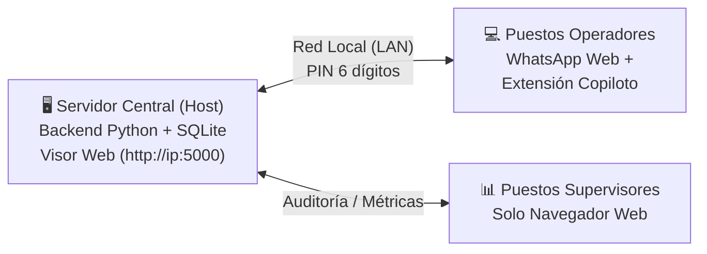

# 💬 WAckup 3.0 — Respaldo Local Pasivo, Copiloto CRM y Modo Equipo

> **WAckup** es la plataforma local definitiva para WhatsApp Web: combina un **respaldo pasivo e incremental offline** con un **Copiloto nativo en panel lateral (`chrome.sidePanel`)**, **Mini-CRM comercial**, métricas de atención y un **Modo Equipo en Red Local (LAN)** con semáforo anti-colisión en tiempo real.
>
> 🌐 **Repositorio Oficial:** [https://github.com/dbonotti/wackup](https://github.com/dbonotti/wackup)  
> 📖 **Documentación Completa:** Para procedimientos paso a paso, arquitectura y guías detalladas, consulta el [Manual de Usuario](MANUAL_DE_USUARIO.md).

---

> [!IMPORTANT]
> **REGLA DE ORO ANTI-BAN (100% Pasivo y Seguro):**  
> WAckup **NO** es un bot de envíos masivos ni una librería no oficial (no usa Baileys, Puppeteer ni WA-JS).
> - **Cero manipulación del DOM**: No inyecta botones, estilos ni paneles dentro de `web.whatsapp.com`.
> - **Cero eventos sintéticos**: Las respuestas rápidas se copian con 1 clic al portapapeles (`navigator.clipboard`) para pegado humano voluntario con `Ctrl+V`.
> - **Lectura criptográfica limpia**: Captura claves efímeras de `window.crypto.subtle` y lee pasivamente el almacenamiento local estándar `IndexedDB` del propio navegador.

---

## 🌟 ¿Qué resuelve WAckup?

1. **Soberanía Total de Datos:**  
   Tus chats, fotos, audios y contactos se respaldan perpetuamente en una base de datos local SQLite bajo tu control absoluto, sin depender de la nube ni exponer datos a terceros.

2. **Atención en Equipo sin Colisiones:**  
   Varios operadores en la misma oficina pueden responder chats concurrentemente. Si dos personas abren la misma conversación, un semáforo visual en tiempo real avisa quién la está atendiendo para no duplicar respuestas.

3. **Copiloto Integrado (Mini-CRM):**  
   Al lado de WhatsApp Web dispones de notas privadas por cliente, asignación de etiquetas, resolución automática de números ocultos (`@lid`) y plantillas de respuesta rápida en 1 clic.

4. **Radar de Atención y Métricas:**  
   Detecta automáticamente los mensajes que esperan respuesta, organizados por urgencia y con ventana de atención configurable para no saturar al equipo con chats antiguos.

---

## 🧩 Arquitectura Simplificada

* **Servidor Central:** Ejecuta el backend y aloja la base de datos única (`whatsapp_chats.db`).
* **Puestos Operadores:** Solo necesitan cargar la **Extensión** en Chrome/Edge. No requieren instalar Python ni bases de datos.
* **Supervisores:** Solo abren el **Visor Web** en su navegador favorito.

---

## 🚀 Inicio Rápido en 3 Pasos

### 1. Iniciar el Servidor (PC Principal)
* Descarga el paquete portable y haz doble clic en **`iniciar_visor.bat`** (sitúa el control en la bandeja del sistema junto al reloj).
* Se abrirá automáticamente el Visor Web en `http://localhost:5000`.

### 2. Instalar la Extensión (Puestos de Trabajo)
* En Chrome/Edge, abre `chrome://extensions` y activa el **Modo de desarrollador**.
* Haz clic en **Cargar descomprimida** y selecciona la carpeta `extension/`.

### 3. Conectar y Trabajar
* Abre WhatsApp Web y haz clic en el ícono de WAckup para desplegar el **Copiloto**.
* En **⚙️ Configuración**, introduce la URL y el PIN de la oficina, elige tu nombre de operador y ¡listo!

---

## 📚 Documentación y Recursos

Para obtener explicaciones exhaustivas sobre configuración de red, gestión de operadores, resolución de problemas y capturas de pantalla, consulta la documentación oficial del proyecto:

* 📖 **[Manual de Usuario y Guía Operativa Oficial](MANUAL_DE_USUARIO.md)**
  - Arquitectura detallada y flujo de sincronización.
  - Guía completa del Copiloto Lateral y Visor Web.
  - Procedimientos de alta de operadores y liberación de sesiones.
  - Respaldo y restauración de bases de datos.
  - Preguntas frecuentes y diagnóstico de red.

---

## 📄 Licencia

Desarrollado bajo licencia MIT. Software libre para uso personal y comercial.
