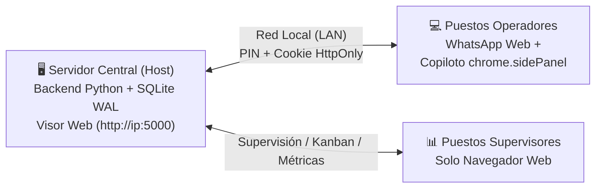

# 💬 WAckup 3.1 — Respaldo Local Pasivo, Copiloto Soporte/CRM, Radar Kanban y Modo Equipo

> **WAckup** es la plataforma local definitiva para WhatsApp Web: combina un **respaldo pasivo e incremental offline** con un **Copiloto nativo en panel lateral (`chrome.sidePanel`)**, **Mesa de Ayuda y Mini-CRM**, **Radar Kanban con Drag & Drop y SLA**, métricas de atención y un **Modo Equipo en Red Local (LAN)** con semáforo anti-colisión y transferencias en tiempo real.
>
> 🌐 **Repositorio Oficial:** [https://github.com/dbonotti/wackup](https://github.com/dbonotti/wackup)  
> 📖 **Documentación Completa:** Para procedimientos paso a paso, arquitectura y guías detalladas, consulta el [Manual de Usuario](MANUAL_DE_USUARIO.md).

---

> [!IMPORTANT]
> **REGLA DE ORO ANTI-BAN (100% Pasivo y Seguro):**  
> WAckup **NO** es un bot de envíos masivos ni una librería no oficial (no usa Baileys, Puppeteer ni WA-JS).
> - **Cero manipulación del DOM**: No inyecta botones, estilos ni paneles dentro de `web.whatsapp.com`.
> - **Cero eventos sintéticos**: Las respuestas rápidas se copian con 1 clic al portapapeles (`navigator.clipboard`) para pegado humano voluntario con `Ctrl+V`.
> - **Lectura criptográfica limpia**: Captura claves efímeras de `window.crypto.subtle` y lee pasivamente el almacenamiento local estándar `IndexedDB` del propio navegador.

---

## 🌟 ¿Qué resuelve WAckup 3.1?

1. **Soberanía Total de Datos:**  
   Tus chats, fotos, audios, documentos y contactos se respaldan perpetuamente en una base de datos local SQLite bajo tu control absoluto, sin depender de la nube ni exponer datos a terceros.

2. **Atención en Equipo sin Colisiones:**  
   Varios operadores en la misma oficina atienden concurrentemente. Un semáforo visual en tiempo real avisa quién tiene el chat abierto (distinguiendo entre WhatsApp Web y el Visor Web) para evitar respuestas duplicadas.

3. **Mesa de Ayuda, Radar & Kanban Interactivo (Novedad 3.1):**  
   - **Kanban de Soporte con Radar en vivo**: Arrastra y suelta (`Drag & Drop`) casos entre estados (*Radar*, *Abierto*, *En espera*, *Resuelto*, *Cerrado*).
   - **Semáforo de SLA dinámico**: Identifica visualmente chats demorados (<15m verde, 15-60m amarillo, >60m rojo, >2h violeta).
   - **Auto-reapertura inteligente**: Si un cliente vuelve a escribir en un ticket resuelto o en espera, el caso se reabre automáticamente en el Radar.
   - **Filtros rápidos en lista de chats**: Conmuta entre `[Todos]`, `[Sin responder]` y `[En espera]` al instante.

4. **Copiloto Ergonómico & Transferencias (Novedad 3.1):**  
   - Respuestas rápidas prioritarias con buscador instantáneo y atajos `Alt + 1` a `Alt + 5`.
   - Botón de 1 clic para auto-asignarse casos ("Tomar caso").
   - Transferencia ágil de casos con notas explicativas y alertas SSE interactivas para el operador receptor.
   - Perfil de trabajo `support` por defecto para una experiencia limpia y centrada en la resolución técnica y operativa.

5. **Blindaje de Red y Seguridad Reforzada (Novedad 3.1):**  
   - Sesiones seguras protegidas con cookies `HttpOnly` y `SameSite=Lax`.
   - Protección contra SSRF y DNS Rebinding validando cabeceras `Host` en red local.
   - Sanitización contra CSV Formula Injection en exportación de contactos.
   - Rotación automática de registros de sincronización (`sync.log`) y optimizaciones WAL sin bloqueos en SQLite.

---

## 🧩 Arquitectura Simplificada

* **Servidor Central:** Ejecuta el backend Python y aloja la base de datos única (`whatsapp_chats.db`).
* **Puestos Operadores:** Solo necesitan cargar la **Extensión** en Chrome/Edge. No requieren instalar Python ni bases de datos.
* **Supervisores:** Abren el **Visor Web** directamente en cualquier navegador moderno de la red local.

---

## 🚀 Inicio Rápido en 3 Pasos

### 1. Iniciar el Servidor (PC Principal)
* Descarga el paquete portable `WAckup_Portable_v3.1.0.zip` y descomprímelo.
* Haz doble clic en **`iniciar_visor.bat`** (se ejecuta en segundo plano alojándose en la bandeja del sistema junto al reloj).
* Se abrirá automáticamente el Visor Web en `http://localhost:5000`.

### 2. Instalar la Extensión (Puestos de Trabajo)
* En Chrome/Edge/Brave, abre `chrome://extensions` y activa el **Modo de desarrollador**.
* Haz clic en **Cargar descomprimida** y selecciona la carpeta `extension/`.

### 3. Conectar y Trabajar
* Abre WhatsApp Web y haz clic en el ícono de WAckup para desplegar el **Copiloto** lateral.
* En **⚙️ Configuración**, introduce la URL y el PIN de la oficina, elige tu nombre de operador y ¡listo!

---

## 📚 Documentación y Recursos

Para obtener explicaciones exhaustivas sobre configuración de red, gestión de operadores, resolución de problemas y capturas de pantalla, consulta la documentación oficial del proyecto:

* 📖 **[Manual de Usuario y Guía Operativa Oficial](MANUAL_DE_USUARIO.md)**
  - Arquitectura detallada y flujo de sincronización pasiva.
  - Guía completa del Copiloto Lateral y Visor Web.
  - Flujo del Kanban de Soporte, SLA y Auto-Reapertura.
  - Procedimientos de alta de operadores, transferencias y liberación de sesiones.
  - Respaldo y restauración de bases de datos.
  - Preguntas frecuentes y diagnóstico de red.

---

## 📄 Licencia

Desarrollado bajo licencia MIT. Software libre para uso personal y comercial.
